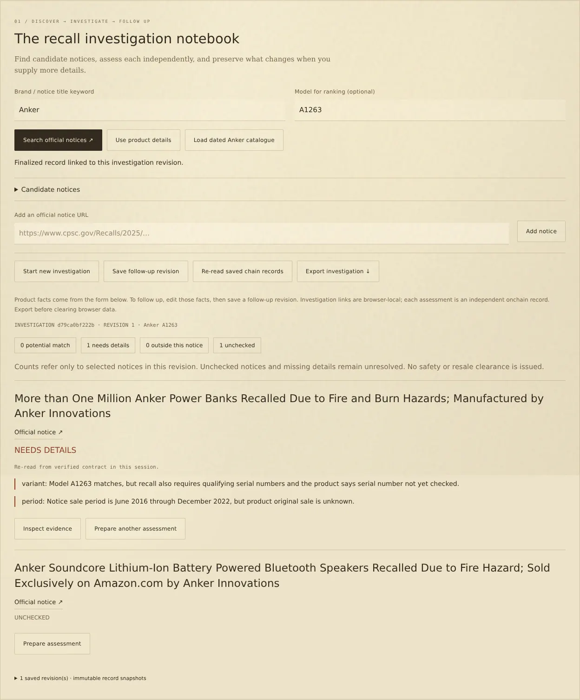
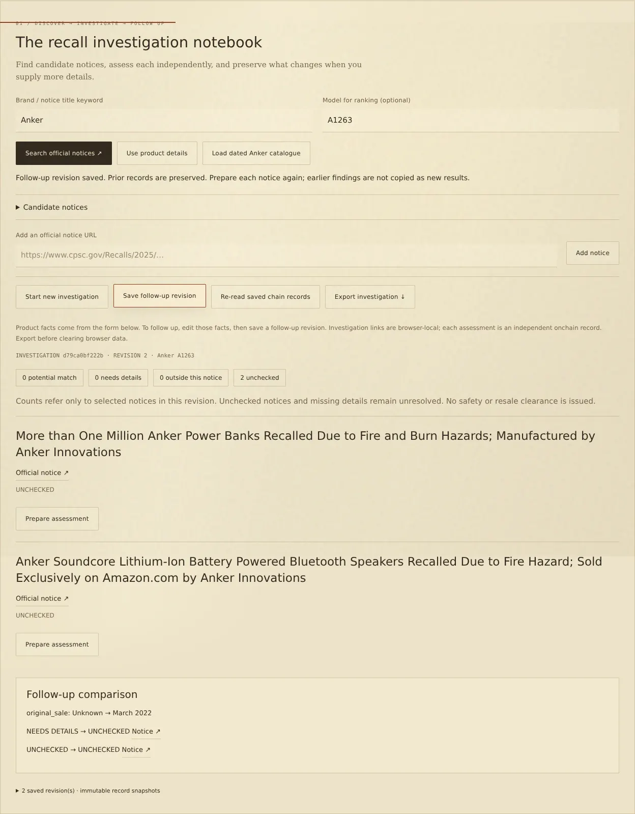

# Recall investigations

An investigation groups one set of product facts, selected CPSC notices, and independent finalized assessments. It supports up to eight notices and sixteen product revisions. The notebook is stored in the current browser; export it before clearing site data or changing devices. There is no cross-device account or server database.

## Discover candidates

The browser requests the [official CPSC Recall API](https://www.cpsc.gov/Recalls/CPSC-Recalls-Application-Program-Interface-API-Information) using `format=json` and `RecallTitle=<keyword>`. Brand/title matching can return unrelated products or omit relevant recalls. Model text overlap changes ranking only; it cannot establish identity, scope, safety, or eligibility for a remedy.

Search results show their retrieval time, source query, recall number, official URL and description. Up to forty candidates are displayed. Only canonical `https://www.cpsc.gov/Recalls/<year>/<slug>` URLs can enter the assessment queue. Deceptive hosts, query strings and fragments are rejected. Results are rendered as text rather than HTML.

If the service fails or times out, the app reports the failure. It never silently substitutes a local fixture. **Load dated Anker catalogue** explicitly loads `data/cpsc-anker.json`, which retains the original response, retrieval time and source query. This saved title search is limited to Anker and may be stale. Run `npm run refresh:catalogue` to refresh it from the same official query, then review the resulting data diff.

You can also add an official URL directly. An empty search result, an unchecked notice, or exclusion from all selected notices does not establish that the product is free of recalls.

## Assess selected notices

Product facts come from the inspection form. Adding the first notice starts an investigation from those facts. **Prepare assessment** fills the selected URL and a request ID scoped to the investigation, revision and notice index. Review the fields, then use the existing source-verified wallet or Studio workflow. Every notice requires its own transaction and signature; selecting candidates does not send transactions.

Only matching product facts and selected URLs can enter a revision's record list. Record input hashes, official notice hashes, dimensions and derived state are validated by the same verifier as single-record readbacks. An example fixture cannot be added as finalized evidence. Existing records can be linked through **Read finalized inspection**, **Read from GenLayer**, or transaction tracking when their product facts and URL match the active revision.

The summary counts the most recently linked record for each selected notice independently. It reports potential matches, records needing details, exclusions from a specific notice, and unchecked notices. It does not combine them into a safety verdict. Each saved record remains inspectable with its owner, request ID and evidence.

## Follow up with more facts

Edit product fields in the inspection form, then select **Save follow-up revision**. A new revision copies the selected notice list but starts with zero assessments. Earlier product facts and records remain in history. New request IDs prevent accidental reuse of an ID already bound to different facts.

The comparison shows changed input fields, before/after per-notice states and changed dimension labels when both revisions have results. Missing-information prompts quote the assessment's `UNKNOWN` reasons; the app never invents serial confirmation or an original purchase date. Follow-up links are local associations, not contract-enforced parent references.

Preparing an assessment freezes its product facts and request ID. Editing them afterwards blocks a prepared submission until the notice is prepared again or the edited facts are saved as a follow-up revision. The existing single-pending-transaction guard still applies. Uncertain submissions must be recovered rather than repeated.

## Saved evidence and exports

An investigation export includes all revisions, exact stored records, record digests, contract addresses and chain IDs. The individual assessments live on GenLayer; investigation grouping and revision links live locally. Internal hash consistency alone cannot prove chain inclusion or authenticate user-supplied product facts.

Reloaded browser records are explicitly cached. **Re-read saved chain records** verifies contract source and exact finalized content for each saved record in the active revision before marking it verified in the current session. A failed re-read does not grant live provenance. The wallet must be reconnected after source binding before another submission.

Starting a new investigation replaces the active browser notebook after a second click. Export the previous case first if it should be retained. This release exports JSON but does not import external investigation files.

## Compatibility

Release 0.3 retains the `recallscope-1` contract protocol, existing Stable Studionet deployment, request recovery, source hash verification and all existing records. It adds a product workflow and official data integration; it does not require a contract migration.

## Interface examples

A two-notice investigation with the existing finalized record linked to its matching notice:

A follow-up with changed product facts, preserved previous evidence, and both notices awaiting new assessment:

